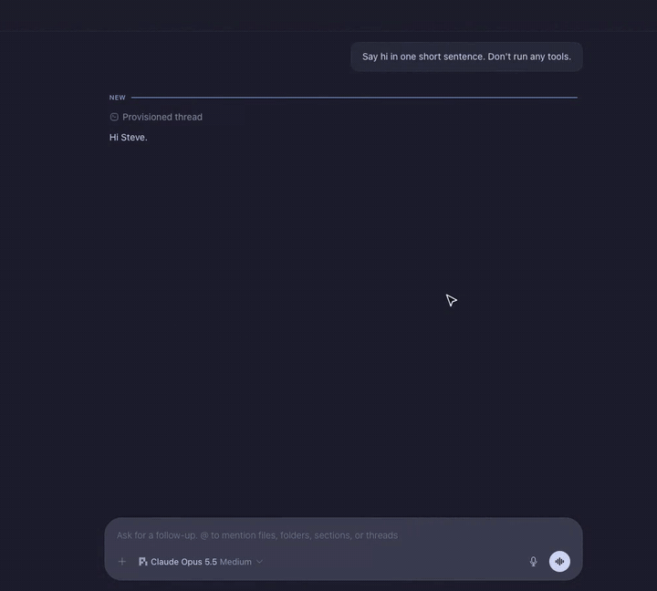

# bb-plugin-voice-mode

Talk to a bb thread hands-free. When a thread's composer is empty and its
agent is idle, the send button becomes a waveform: click it and you are in a
full-duplex voice chat.
The voice model hands real work to the thread's agent, tells you when the
agent is done, and stops talking the moment you talk over it.

[](https://github.com/steveafrost/bb-plugin-voice-mode/releases/download/v0.1.0/voice-mode-demo-public.mp4)

[Watch the full 90-second demo with sound](https://github.com/steveafrost/bb-plugin-voice-mode/releases/download/v0.1.0/voice-mode-demo-public.mp4).

- `server.ts` — the backend. A `bb.http` WebSocket route relays browser audio
  to an [OpenAI Realtime](https://platform.openai.com/docs/guides/realtime)
  session and runs the voice model's tools (`send_to_agent`, `stop_agent`,
  `get_agent_status`) against the thread with `bb.sdk`. When the agent's turn
  settles, it hands the result back to the voice model to summarize aloud.
- `app.tsx`, `session.ts`, `audio.ts` — the frontend. A composer action swaps
  bb's send button for the waveform while the composer is empty and the agent
  is idle, and shows a
  pill (live waveform, status, mute, end) in place of bb's mic while a session
  runs. Mic capture is 24 kHz PCM with echo cancellation; playback can be cut
  instantly on barge-in.
- `skills/voice-mode/SKILL.md` — tells the thread's agent how voice messages
  arrive (the user's own transcribed words, optionally marked `[Voice Mode]`)
  and that its final message is read back.
- `test/` — backend tests against a fake host and a fake Realtime socket.

## Setup

Pick one in **Settings → Plugins → Voice Mode** (or `bb plugin config voice-mode`):

- **OpenAI API key** — set `openaiApiKey`. Choose `model` (`gpt-realtime-2`
  by default) and `voice`. The key is only ever sent to
  `wss://api.openai.com/v1/realtime`, and audio goes straight to OpenAI,
  around any company proxy. For another endpoint, use a connection plugin.
- **A connection plugin** — any installed plugin that publishes a discoverable
  `realtimeConnection` rpc returning
  `{ protocol: "openai-realtime", url, headers, model? }` (`url` must be
  `wss://`). That plugin picks the model; Voice Mode's `model` setting
  doesn't apply. This lets a company proxy own credentials and the model
  choice.

`connection` decides which one:

- `auto` (the default) prefers an installed connection plugin. If none is
  available, or discovering or resolving its connection fails (for example,
  it has no token or returns an invalid connection), Voice Mode uses your
  configured OpenAI API key instead. Plugin resolution failures are logged
  on the server; switching to the key does not ask for confirmation. This
  sends audio and session context directly to OpenAI, bypassing any company
  proxy, and uses your OpenAI API account.
- `plugin` uses only a connection plugin. If it is missing or fails, the
  session fails; a configured OpenAI API key is never used. Choose this mode
  when sessions must stay on your company's connection.
- `openai-api-key` uses only the configured OpenAI API key and ignores
  connection plugins.

Without a usable plugin connection or API key, the session fails with setup
instructions. A plugin WebSocket handshake failure gets one connection
refresh attempt; the same selection rules apply if that refresh fails to
resolve a connection. Socket failures do not otherwise automatically switch
providers.

Keys stay on the bb server host; the browser only talks to the plugin's own
WebSocket route.

## Use

- Empty composer with the agent idle → click the waveform ("Start new voice
  chat"), or press **Ctrl+Shift+V** (Codex's shortcut) any time, including
  while the agent works. The same keys end the session. Rebind them in
  Settings → Keyboard ("Start or end voice chat"); the command is also in the
  palette.
- Talk normally. Ask for anything that needs the codebase and the voice model
  sends it to the agent; ask "is it done?" any time; say "stop" to stop the
  agent. If the agent stops to ask you something (a question or a
  permission), the voice tells you to answer it in bb.
- Talk over the voice to interrupt it. The mute button keeps the session open
  without sending your mic; the × ends it.
- Leave the thread (Settings, another thread) and the conversation keeps
  going in a pill at the bottom of the sidebar, above its footer (bottom-left
  of the window when the sidebar is collapsed): mute, end, or ↩ back to the
  thread from there. `widgetStyle` picks `detailed` (with the thread's name,
  the default) or `compact` (one line, no name).

## Privacy

While a session is on, the realtime provider you configured gets your
microphone audio, the thread title, the agent's latest message when you
start, and each agent reply that finishes during the session (first 2,500
characters of each). Nothing is sent until you start a session.

Agent replies can quote text from anywhere (issues, web pages, files), so
Voice Mode treats them as data: they never go in the voice model's
instructions, replies to them can't call tools, and the voice model can
forward at most one message to the agent per thing you say. By default that
message is your own words as transcribed, not the voice model's rewording, so
the agent sees what you actually said (filler and mishearings included). Set
`messageText` to `rewritten` to have the voice model write a clean instruction
instead; it reads better but can drift from what you said. Turn on
`prefixMessages` to start spoken messages with `[Voice Mode]` so the agent can
tell them from typed ones; it's off by default.

## Limits

- bb has no plugin slot for its send button or mic. Voice Mode finds them by
  bb's DOM markers (`[data-promptbox-send-menu]`,
  `button[aria-label="Start voice input"]`, `[data-promptbox-submit-group]`).
  If a bb update changes them, the waveform and pill fall back to the
  composer's plugin action slot beside bb's own buttons: less Codex-like, but
  still there. bb's own send and dictation keep working either way.
- One session at a time per bb server; starting one in another thread ends
  the first.
- A session ends itself after 5 minutes with no speech and no reply playing
  (20 minutes while an agent turn is running), and after 30 minutes in any
  case, so a forgotten session doesn't keep streaming.

## Develop

```sh
npm install
npm run typecheck && npm test
bb plugin build && bb plugin install . --yes
```
